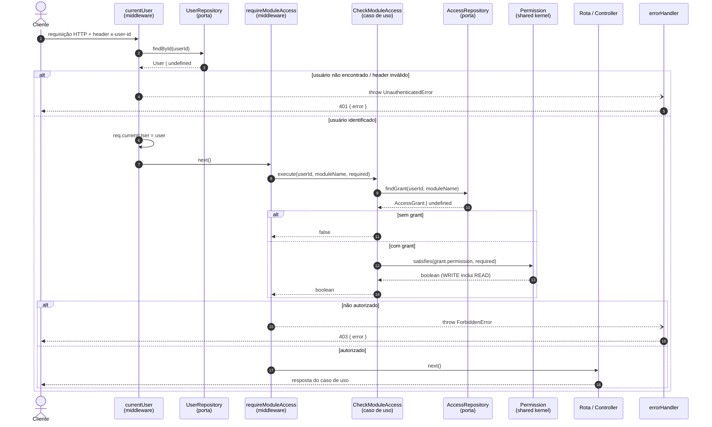
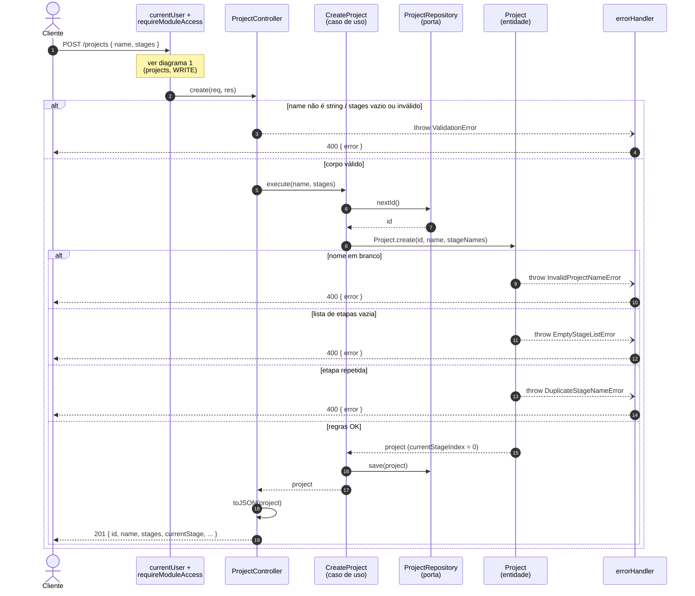
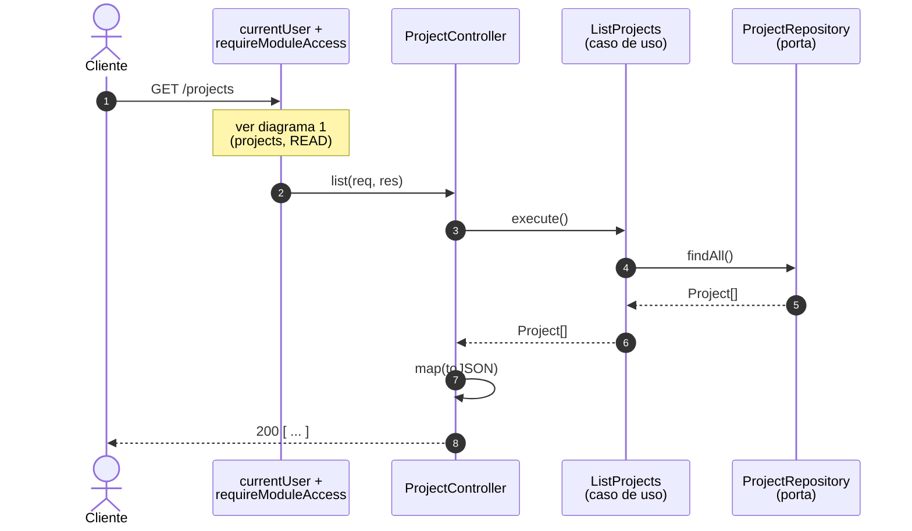
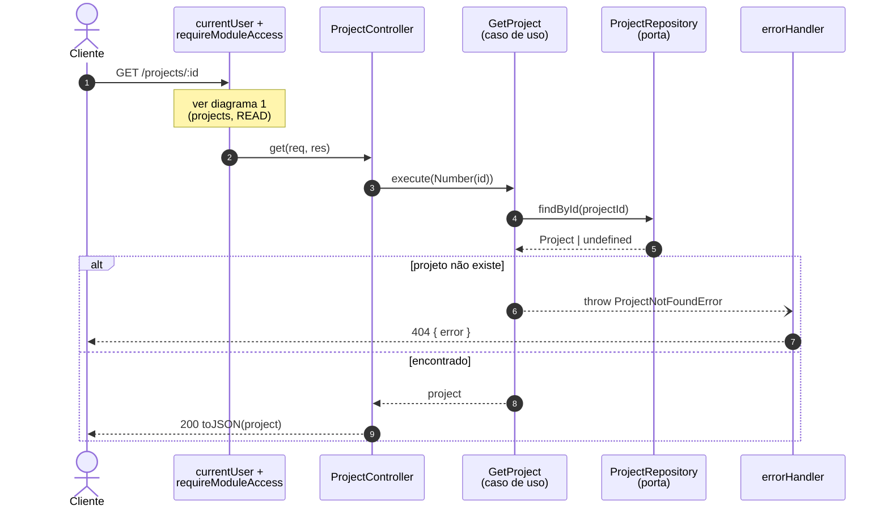
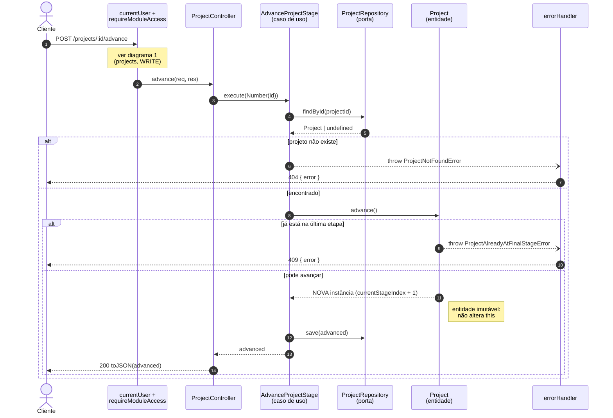
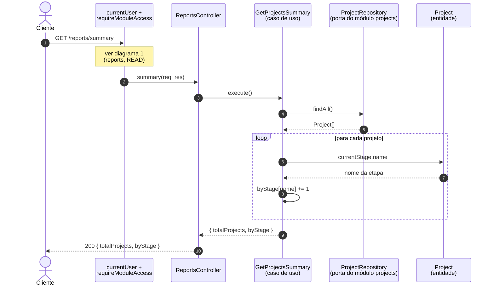
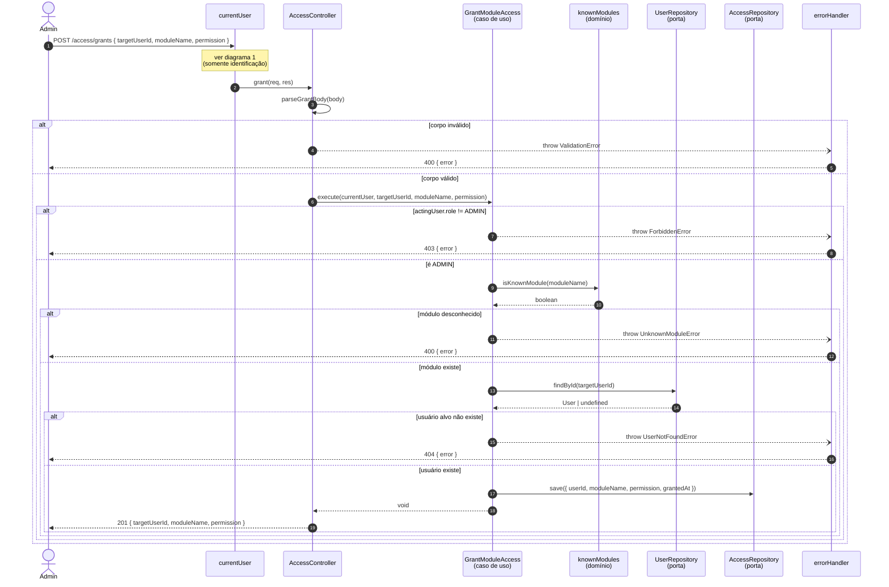
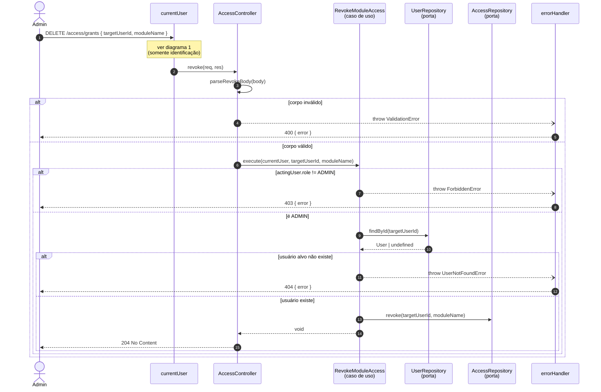
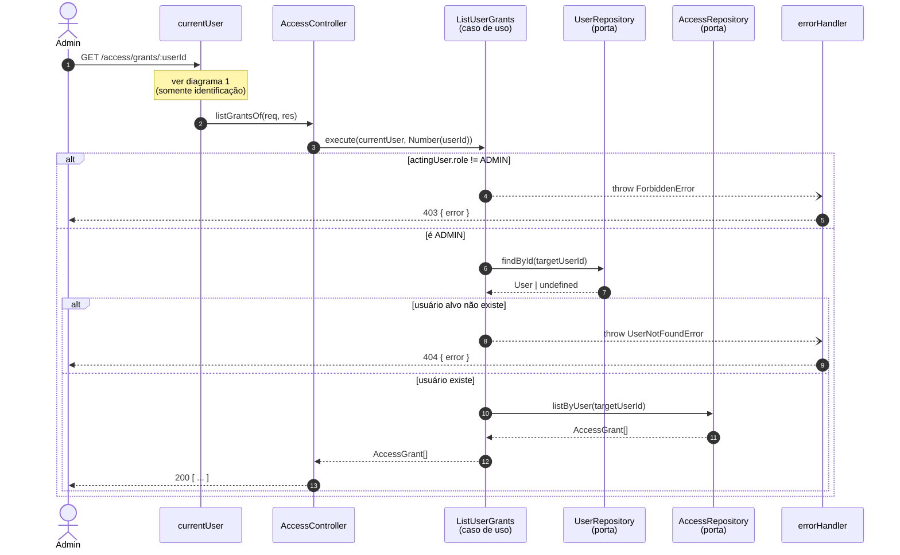
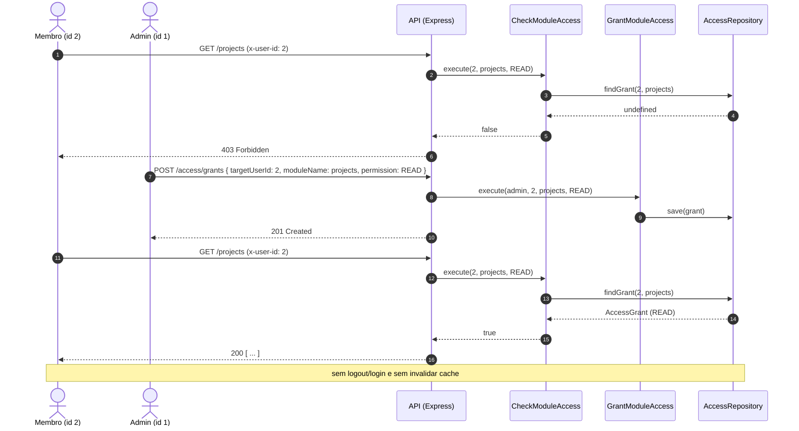

# Aula 06 — Diagramas de Sequência dos Casos de Uso

Diagramas de sequência (Mermaid) dos casos de uso do projeto [`project-management`](./project-management/), seguindo as camadas da arquitetura hexagonal:

| Camada | Peças |
|---|---|
| **Adaptador primário** (driving) | `currentUser`, `requireModuleAccess`, rotas e Controllers HTTP, `errorHandler` |
| **Aplicação** (casos de uso) | `CreateProject`, `ListProjects`, `GetProject`, `AdvanceProjectStage`, `GetProjectsSummary`, `GrantModuleAccess`, `RevokeModuleAccess`, `ListUserGrants`, `CheckModuleAccess` |
| **Domínio** | `Project`, `User`, `AccessGrant`, `Permission`, `knownModules` |
| **Porta de saída** → **adaptador secundário** | `ProjectRepository`, `UserRepository`, `AccessRepository` → `InMemory*Repository` |

> Nos diagramas, os repositórios aparecem como a **porta** (interface). Em tempo de execução quem responde é o adaptador `InMemory*Repository` injetado pela composition root (`server.ts`) — o caso de uso não sabe disso.

---

## 1. Pipeline comum: identificação + autorização por módulo

Toda requisição passa primeiro pelo middleware `currentUser`. As rotas de `projects` e `reports` passam também por `requireModuleAccess`, que delega ao caso de uso **CheckModuleAccess**. As rotas de `access` **não** passam por `requireModuleAccess` (a regra ali é o papel `ADMIN`, checado dentro do caso de uso).

> Como `CheckModuleAccess` relê o `AccessRepository` em **toda** requisição (sem cache), um grant concedido pelo admin vale já na próxima chamada do usuário.

---

## 2. Módulo `projects`

### 2.1 Criar projeto — `POST /projects` (exige `projects:WRITE`)

### 2.2 Listar projetos — `GET /projects` (exige `projects:READ`)

### 2.3 Consultar projeto — `GET /projects/:id` (exige `projects:READ`)

### 2.4 Avançar etapa — `POST /projects/:id/advance` (exige `projects:WRITE`)

---

## 3. Módulo `reports`

### 3.1 Resumo de projetos — `GET /reports/summary` (exige `reports:READ`)

O módulo `reports` reaproveita a **porta** `ProjectRepository` do módulo `projects` (e não o adaptador concreto). A permissão exigida é no módulo `reports`, independente de `projects`.

---

## 4. Módulo `access`

Estas rotas passam só pelo `currentUser` (não há `requireModuleAccess`). A regra "apenas `ADMIN`" mora no caso de uso.

### 4.1 Conceder acesso — `POST /access/grants`

### 4.2 Revogar acesso — `DELETE /access/grants`

Revogar um módulo desconhecido não é erro (é um no-op), por isso não há checagem de `knownModules`.

### 4.3 Listar concessões de um usuário — `GET /access/grants/:userId`

---

## 5. Cenário integrado: concessão vale na próxima requisição

Mostra a interação entre `GrantModuleAccess` e `CheckModuleAccess` — o ponto central da aula (autorização lida do repositório a cada requisição, sem cache em sessão/token).

