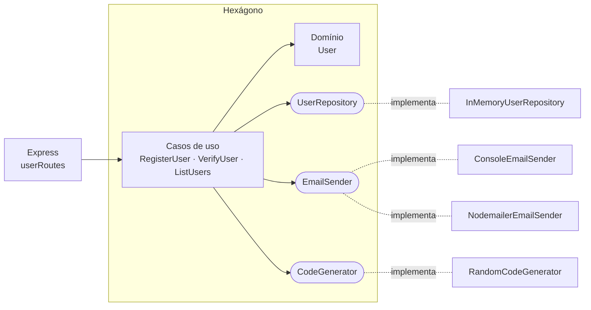

# Aula 08 — Cadastro com verificação por e-mail (arquitetura hexagonal)

Uma API mínima de cadastro de usuários: o usuário se cadastra, recebe um **código de 6 dígitos por e-mail** e confirma a conta enviando esse código de volta.

O objetivo é mostrar, num projeto pequeno o bastante para ler numa aula, as peças da arquitetura hexagonal (Aula 06) — e, principalmente, como **trocar a forma de enviar e-mail sem mexer em uma linha do domínio nem dos casos de uso**.

Material de conceito: [`Aula06/arquitetura-hexagonal.md`](../../Aula06/arquitetura-hexagonal.md).

---

## Como rodar

```bash
cd Aula08/cadastro
cp .env.example .env
npm install
npm run dev      # http://localhost:3008
npm test         # testes dos casos de uso, sem HTTP e sem SMTP
```

As requisições de exemplo estão em [`test.http`](test.http) (extensão REST Client do VS Code).

## A API

| Método | Rota            | Corpo                  | Respostas                                    |
| ------ | --------------- | ---------------------- | -------------------------------------------- |
| POST   | `/users`        | `{ name, email }`      | 201 · 400 dados inválidos · 409 e-mail já usado |
| POST   | `/users/verify` | `{ email, code }`      | 200 · 400 código errado · 404 · 409 já verificado |
| GET    | `/users`        | —                      | 200 lista com `verified: true/false`         |

## As duas estratégias de e-mail

A estratégia é escolhida no `.env`:

| `EMAIL_STRATEGY` | Adaptador                                                              | O que acontece                                  |
| ---------------- | ---------------------------------------------------------------------- | ----------------------------------------------- |
| `console`        | [`ConsoleEmailSender`](src/adapters/email/ConsoleEmailSender.ts)       | O código é impresso no terminal da API.         |
| `nodemailer`     | [`NodemailerEmailSender`](src/adapters/email/NodemailerEmailSender.ts) | Envia por SMTP com as variáveis `SMTP_*`.       |

Para testar o Nodemailer sem e-mail real, crie uma conta em <https://ethereal.email>, copie usuário e senha para o `.env` e troque `EMAIL_STRATEGY=nodemailer`. O console mostra um link para ver a mensagem capturada. O `.env.example` também explica como usar o Gmail.

---

## O mapa do projeto

```
src/
├── domain/                      ← NÚCLEO: não importa nada de fora
│   ├── User.ts                    entidade + regras (cadastro válido, verificar código)
│   └── errors.ts                  erros de negócio (sem status HTTP)
├── application/
│   ├── ports/                   ← o que o núcleo PRECISA do mundo (interfaces)
│   │   ├── UserRepository.ts
│   │   ├── EmailSender.ts
│   │   └── CodeGenerator.ts
│   └── useCases/                ← o que o núcleo OFERECE ao mundo
│       ├── RegisterUser.ts
│       ├── VerifyUser.ts
│       └── ListUsers.ts
├── adapters/                    ← tecnologia concreta
│   ├── http/                      primário (driving): Express
│   ├── memory/                    secundário: repositório em Map
│   ├── email/                     secundário: Console e Nodemailer
│   └── code/                      secundário: gerador aleatório
└── index.ts                     ← COMPOSITION ROOT: lê .env e conecta tudo
```



As setas sólidas são dependências de código; repare que **todas apontam para dentro**. Os adaptadores dependem das portas, nunca o contrário.

---

## Roteiro de leitura (para a aula)

Leia nesta ordem — de dentro para fora do hexágono. Cada arquivo tem um comentário `HEXAGONAL:` explicando seu papel.

### 1. O domínio — [`src/domain/User.ts`](src/domain/User.ts)

- `User.register()` valida nome e e-mail. `user.verify(code)` confere o código e o invalida depois do uso.
- **Observe os imports:** só `./errors.js`. Nada de Express, Nodemailer ou `process.env`.
- Pergunta para a turma: *por que o `User` recebe o código pronto em vez de gerá-lo?*

### 2. As portas — [`src/application/ports/`](src/application/ports/)

- `EmailSender` tem um único método: `sendVerificationCode(to, code)`. Ele fala a língua do **negócio**, não do SMTP — não existe `host`, `transporter` nem `sendMail` na interface.
- `CodeGenerator` existe para tirar a aleatoriedade de dentro do caso de uso (e assim conseguir testá-lo).
- `UserRepository` é assíncrono mesmo sendo em memória: prepara o terreno para um banco real.

### 3. Os casos de uso — [`src/application/useCases/`](src/application/useCases/)

- [`RegisterUser`](src/application/useCases/RegisterUser.ts) recebe **três interfaces** no construtor e orquestra: gerar código → criar `User` → checar duplicidade → enviar e-mail → salvar.
- Pergunta: *por que enviar o e-mail antes de salvar?* (Dica: o que acontece se o SMTP estiver fora do ar?)
- [`VerifyUser`](src/application/useCases/VerifyUser.ts) só busca, delega para `user.verify()` e salva — a regra mora no domínio.

### 4. Os adaptadores secundários — [`src/adapters/email/`](src/adapters/email/)

- Coloque [`ConsoleEmailSender`](src/adapters/email/ConsoleEmailSender.ts) e [`NodemailerEmailSender`](src/adapters/email/NodemailerEmailSender.ts) lado a lado: mesma interface, comportamentos diferentes. Isso é o padrão **Strategy** aparecendo naturalmente na arquitetura hexagonal.
- `NodemailerEmailSender` é o **único** arquivo que importa `nodemailer`, e recebe a configuração pronta pelo construtor — ele não lê `process.env`.

### 5. O adaptador primário — [`src/adapters/http/`](src/adapters/http/)

- [`userRoutes.ts`](src/adapters/http/userRoutes.ts) é fino: verifica se os campos são strings (formato), chama o caso de uso, devolve JSON.
- [`errorHandler.ts`](src/adapters/http/errorHandler.ts) é o único lugar que transforma erro de domínio em status HTTP. Erros desconhecidos (ex.: SMTP fora do ar) viram `500 Erro interno`, sem vazar detalhes.

### 6. A composition root — [`src/index.ts`](src/index.ts)

- Único arquivo que lê `process.env` e que conhece as classes concretas.
- `createEmailSender()` é onde a estratégia é escolhida. **É aqui — e só aqui — que o `.env` muda o comportamento do sistema.**

### 7. Os testes — [`test/cadastro.test.ts`](test/cadastro.test.ts)

- Testam os casos de uso com dublês: um `CodeGenerator` que sempre devolve `"123456"` e um `SpyEmailSender` que só guarda o que foi "enviado".
- Sem servidor, sem SMTP, sem aleatoriedade — é o retorno prático de ter definido as portas.

---

## Demonstração sugerida

1. Rode com `EMAIL_STRATEGY=console`, cadastre um usuário pelo `test.http`, copie o código do terminal e verifique a conta.
2. Pare a API, mude para `EMAIL_STRATEGY=nodemailer` (com uma conta Ethereal) e repita. Abra o link de pré-visualização.
3. Mostre o `git diff`: **só o `.env` mudou.**

## Exercícios

Cada um deve ser feito sem alterar o domínio (exceto o 2, que é uma nova regra de negócio).

1. **Nova estratégia:** crie um `FileEmailSender` que grava o e-mail em `emails/<destinatário>.txt` e registre-o em `createEmailSender()`.
2. **Expiração:** o código passa a valer 10 minutos. Onde mora a regra? Como testar sem esperar 10 minutos? (Dica: uma porta `Clock`.)
3. **Reenviar código:** crie o caso de uso `ResendVerificationCode` e a rota `POST /users/resend`.
4. **Persistência real:** implemente `PrismaUserRepository` (como no projeto [`Aula07/notificacoes`](../../Aula07/notificacoes/)) e troque-o em `src/index.ts`.
5. **Senha:** adicione senha ao cadastro, com uma porta `PasswordHasher` e um adaptador usando `node:crypto` (`scrypt`) ou `bcrypt`.
